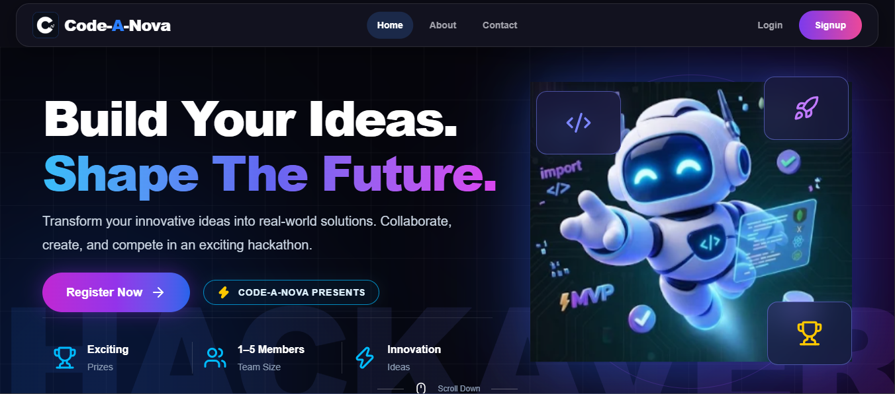
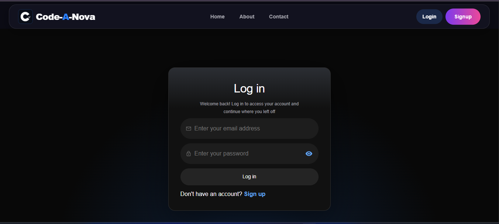
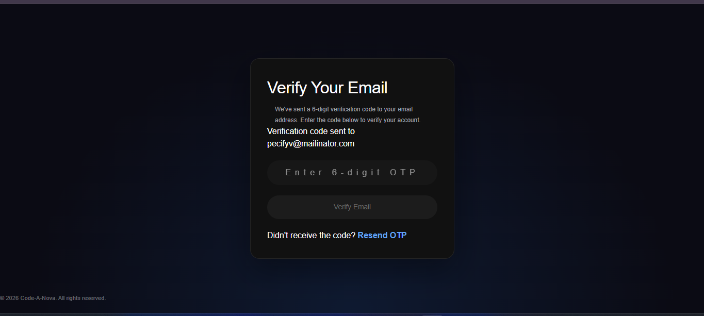
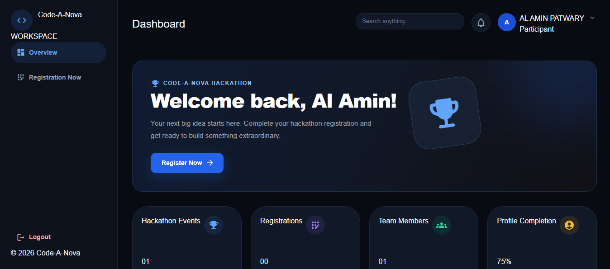
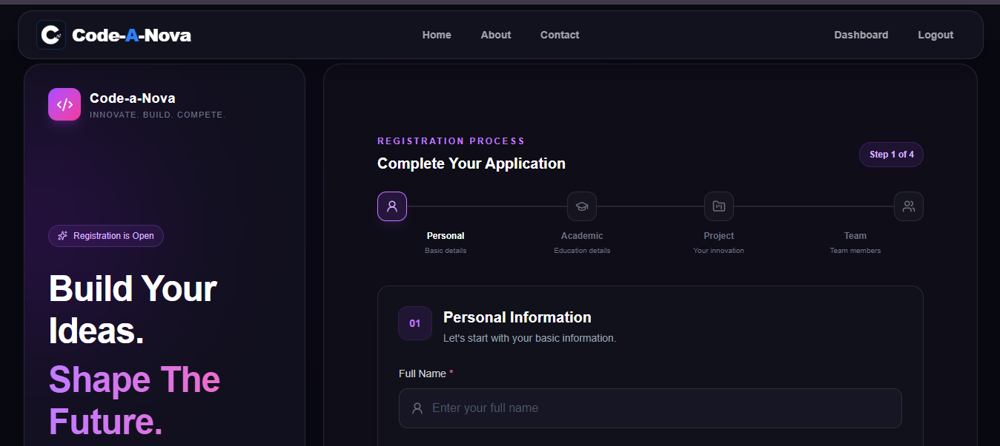

# Code-A-Nova Hackathon Registration Portal — Frontend

A responsive and user-friendly Hackathon Registration Portal built with React.js. This frontend allows users to create accounts, verify their email addresses, log in, and manage their hackathon registration through a dashboard.

## 🚀 Live Demo

**Frontend:** [https://codeanova-hackathon-portal.vercel.app/](https://codeanova-hackathon-portal.vercel.app/)

## 📸 Screenshots

### Landing Page


### Signup Page


### OTP Verification


### Login Page


### Dashboard


### Hackathon Registration


## 🛠️ Technologies Used

- **React.js** — UI development
- **Vite** — Development server and build tool
- **React Router DOM** — Client-side routing
- **Tailwind CSS** — Utility-first styling
- **Material UI (MUI)** — UI components
- **Framer Motion** — Animations and transitions
- **Axios** — API requests
- **React Context API** — Authentication state management
- **JavaScript (ES6+)** — Application logic
- **Vercel** — Deployment

## ✨ Features

- Responsive and modern user interface
- User registration and login
- Email verification with OTP
- Protected routes for authenticated users
- Authentication state management
- JWT-based API authentication
- User dashboard
- Hackathon registration
- View personal registration details
- Profile management
- Reusable UI components
- Smooth animations and transitions
- Backend API integration

## 📁 Project Structure

```text
client/
├── public/
│   └── screenshots/
├── src/
│   ├── assets/
│   ├── components/
│   ├── context/
│   ├── hooks/
│   ├── layouts/
│   ├── pages/
│   │   ├── auth/
│   │   └── dashboard/
│   ├── routes/
│   ├── services/
│   ├── utils/
│   ├── App.jsx
│   └── main.jsx
├── .env.example
├── .gitignore
├── index.html
├── package.json
├── pnpm-lock.yaml
└── vite.config.js
```

## ⚙️ Installation & Setup

### 1. Clone the repository

```bash
git clone <your-github-repository-url>
```

### 2. Navigate to the frontend directory

```bash
cd hackathon-registration-portal/client
```

### 3. Install dependencies

```bash
pnpm install
```

### 4. Configure environment variables

Create a `.env` file in the client directory.

Copy the configuration from `.env.example`:

```env
VITE_API_URL=http://localhost:5000/api
```

For production, configure the following environment variable in Vercel:

```env
VITE_API_URL=https://hackathon-registration-murex.vercel.app/api
```

### 5. Start the development server

```bash
pnpm dev
```

The application will run at:

```text
http://localhost:5173
```

## 🏗️ Build for Production

To create an optimized production build:

```bash
pnpm build
```

To preview the production build locally:

```bash
pnpm preview
```

## 🌐 Deployment

The frontend is deployed on **Vercel**.

**Live URL:** [https://codeanova-hackathon-portal.vercel.app/](https://codeanova-hackathon-portal.vercel.app/)

## 🔗 Related Repository

**Backend:** `../server` (included in the project repository).

## 👨‍💻 Author

**Al Amin Patwary**

- **GitHub:** [https://github.com/malamin59](https://github.com/malamin59)
- **Portfolio:** [https://alamin-15553.web.app/](https://alamin-15553.web.app/)
- **LinkedIn:** [https://www.linkedin.com/in/alamin-epb](https://www.linkedin.com/in/alamin-epb)

---

⭐ If you find this project interesting, feel free to explore the repository!
